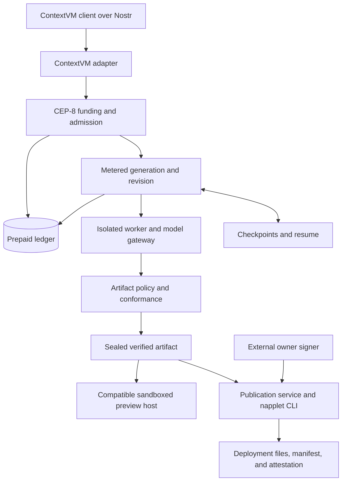

<div align="center">

# napplet-cvm

Turn a focused text idea into a verified Nostr applet through ContextVM.

[](https://github.com/napplet/cvm/actions/workflows/toolchain-candidate.yml)
[](package.json)

</div>

## What is this?

**napplet-cvm** is a generation service for small, single-purpose Nostr web applets called *napplets*. Its intended workflow lets a user fund a Nostr-linked account, describe an idea, iterate within an approved spend cap, preview a verified build, and publish a manifest they sign themselves. ContextVM carries the public v1 interface over Nostr; the generation, billing, and session core stays independent of the transport.

**Status: in development; live release certification is pending.** The repository contains the core services, provider adapters, deterministic tests, and release controller. Production readiness, the five-second p95 admission target, and recovery across infrastructure failures still require protected live evidence. See the [current project state](.planning/STATE.md) for the remaining release gates.

Production certification is [deferred until production work resumes](docs/runbooks/production-readiness-deferred.md); it does not block local development or development e2e tests.

## Quick start

Use **Git, Bun 1.3.14, and a running Docker engine with Compose 2.39 or newer**. The development worker runs Linux ARM64; the local relay runs AMD64, so Docker must support both platforms (as Docker Desktop does on Apple Silicon).

```sh
git clone https://github.com/napplet/cvm.git napplet-cvm
cd napplet-cvm
bun install --frozen-lockfile
bun scripts/dev.ts up
```

Open the printed URL, click **Connect**, fund the account with local test money, and generate a napplet. The default model is a labeled deterministic fixture. For real generation using your ChatGPT subscription, choose **Continue with ChatGPT**; sign-in activates a model automatically. Model changes apply immediately, and your sign-in and selection persist across restarts. [Sign-in and test instructions](docs/runbooks/development-gui.md#chatgpt-subscription-sign-in-for-local-development). See the [workspace walkthrough](docs/runbooks/development-gui.md#try-the-execution-flow).

| Command | Purpose |
| --- | --- |
| `bun test` | Run the repository's test suite. |
| `bun run test:promotion` | Check promotion tracing and sealed-toolchain policy. |
| `bun run candidate:workflow-check` | Run the candidate workflow tests. |
| `bun run test:design-slice` | Write Phase 1 design evidence, including explicit native-runtime blockers. |

Design evidence and fixture passes establish local behavior. Release promotion additionally requires real browser, provider, payment, model, recovery, and publication observations.

## Local development workspace

The development workspace starts the real local service graph: ContextVM over a relay, Cashu and NWC payment rails, PostgreSQL, the metered model boundary, the pinned isolated worker, artifact verification, and the compatible preview host. Product commands stay on ContextVM; the workspace HTTP server serves only static assets, non-secret bootstrap facts, health, preview bytes, the development faucet, and protected local model/sign-in controls.

Prerequisites are Docker with Compose 2.39 or newer, Bun 1.3.14, and repository dependencies. The browser test package has its own frozen lockfile; the launcher checks it and Chromium before reporting ready.

```sh
bun install --frozen-lockfile
bun scripts/dev.ts up
bun scripts/dev.ts status
```

`up` prints the loopback workspace URL only after semantic readiness succeeds. `status` prints a redacted JSON report with the URL, model mode, and local state root. Use the exact lifecycle commands below; `down` preserves development state, while `reset` requires confirmation and removes only the selected repository-scoped instance.

| Command | Purpose |
| --- | --- |
| `bun scripts/dev.ts up` | Start or reuse the complete local workspace and print its loopback URL. |
| `bun scripts/dev.ts status` | Report readiness, mode, URL, and state locations without secret values. |
| `bun scripts/dev.ts test --case=contextvm-funding` | Run Chromium, relay, ContextVM, Cashu/NWC, and ledger evidence. |
| `bun scripts/dev.ts test --case=generation-preview` | Run source, metering, pinned worker, verification, and compatible-preview evidence. |
| `bun scripts/dev.ts test --case=continuation-revision` | Run pending-action funding/restart/explicit-resume and revision/version evidence. |
| `bun scripts/dev.ts test --case=chatgpt-oauth` | Test OAuth and streamed inference fixtures through the real local build/preview flow. |
| `bun scripts/dev.ts test --case=full` | Run the composed browser, durable-state, security, responsive, and accessibility gate. |
| `bun scripts/dev.ts down` | Stop the selected workspace while preserving its development data. |
| `bun scripts/dev.ts reset --confirm` | Remove only the selected workspace's labeled containers, volumes, checkpoints, artifacts, and local state. |

The default model mode is **Deterministic fixture**: only the external model response is substituted, while the relay, signed ContextVM path, rails, SQL ledger, worker, build, verifier, artifact repository, and preview host are real local boundaries. ChatGPT OAuth mode uses your selected account’s subscription allowance, with actual token counts and synthetic local test sats. API-key mode remains available through explicit configuration and can incur API charges. Both appear as distinct provider modes in `status` and the workspace; it is never silently represented as deterministic evidence. See the [development GUI runbook](docs/runbooks/development-gui.md) for setup, inspection, recovery, and limitations.

For local payment development, start Docker and run `bun scripts/dev-payments.ts`. This automatically provisions two Cashu mints, a local relay, a funded NWC wallet with test money, and a migrated PostgreSQL ledger. Run `bun scripts/dev-payments.ts test` for isolated payment and application funding tests, including ledger replay checks after restart. See [development payments](docs/runbooks/development-payments.md) for credentials, application integration, and stop/reset commands.

## Generation contract

- **One focused applet:** bounded text ideas and revisions produce a sandboxed napplet through the pinned napplet scaffold, SDK, skills, and CLI.
- **Prepaid, metered work:** CEP-8 Lightning and Cashu top-ups fund a Nostr-linked ledger. Generation accounts for measured API usage within the funded balance and approved cap.
- **Immediate admission:** capacity is reserved before work is accepted. The target is isolated execution within five seconds at p95, with no durable request queue.
- **Resumable sessions:** insufficient funds pause work. The continuity contract keeps a live worker for ten minutes and durable checkpoints for explicit resume for 30 days.
- **Verified output:** artifact policy and browser conformance gate preview and publication. Generated applets use shell-mediated capabilities for storage, relay access, and signing.
- **User-owned publication:** the user approves publication and signs the owning manifest externally. The service uses `@napplet/cli` for deployment and adds a separate build attestation without taking custody of the user's private key.

These are the v1 product contracts; the release status above tracks their live certification.

## Architecture

The main components implement this flow:



TypeScript and Bun host the service code. Persistence uses PostgreSQL with Kysely and `pg`; Cloud SQL is the selected v1 database authority. Modal and Fly worker adapters share a worker contract, with production selection dependent on live evidence. The release controller binds certification to the exact candidate, source, topology, and approved effects.

## Project structure

```text
napplet-cvm/
├── .planning/       # Requirements, roadmap, decisions, and verification state
├── config/          # Local and protected certifier configuration contracts
├── docs/            # Operator runbooks
├── evidence/        # Design and certification records
├── fixtures/        # Minimal applets and rejection cases
├── infra/           # Toolchain image, network policy, and telemetry assets
├── migrations/      # Ledger, session, checkpoint, and publication schemas
├── policy/          # Upstream verification coverage
├── scripts/         # Verification, evaluation, and release commands
├── src/             # Domain services, adapters, workers, and release controller
├── tests/           # Unit, integration, contract, and evaluation fixtures
├── toolchains/      # Pinned candidates and generated-project lockfiles
├── AGENTS.md        # Repository workflow and agent instructions
├── bun.lock         # Service dependency lockfile
├── package.json     # Scripts and exact dependency versions
└── tsconfig.json    # TypeScript configuration
```

## Release certification

Start with the [release certification runbook](docs/runbooks/release-certification.md). The controller derives the candidate-bound configuration, cost estimate, authorization request, and evidence; protected execution requires the platform's pinned deployment configuration and an exact approval receipt.

The checked-in local configuration is evidence-only. It reports `RELEASE_PRODUCTION_EXECUTION_CONFIG_REQUIRED` at the protected execution boundary. Local test results cannot promote a release without the required live records.

## Documentation

| Resource | Contents |
| --- | --- |
| [Project definition](.planning/PROJECT.md) | Product goals, boundaries, and v1 scope. |
| [Requirements](.planning/REQUIREMENTS.md) | Acceptance criteria and requirement tracking. |
| [Roadmap](.planning/ROADMAP.md) | Implementation phases and milestones. |
| [Current state](.planning/STATE.md) | Progress, blockers, and the active release checkpoint. |
| [Certifier configuration](config/README.md) | Local development and protected configuration ownership. |
| [Release certification](docs/runbooks/release-certification.md) | Authorization, evidence, interruption recovery, and cleanup. |
| [Development GUI](docs/runbooks/development-gui.md) | Local launcher, workspace operation, inspection, recovery, and development-only limits. |
| [Deferred production readiness](docs/runbooks/production-readiness-deferred.md) | Production work that remains outside the local development environment. |

## Development

Read [AGENTS.md](AGENTS.md) before changing the repository. Work is tracked through GSD: use `gsd-quick` for small changes, `gsd-debug` for investigations, and `gsd-execute-phase` for planned implementation. Keep the service dependencies in `bun.lock` and generated-napplet toolchains in `toolchains/` aligned with their verification evidence, and run the tests relevant to your change.
