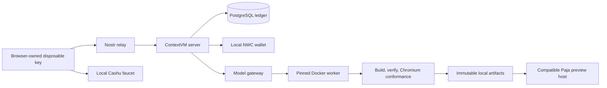

# Development GUI runbook

This runbook operates the local development workspace. It is development evidence only. Its Cashu and NWC rails use local test money, but enabling a configured provider can make billable model API calls. It does not authorize a production deployment, complete `SESS-02` or `OPS-01` through `OPS-04`, or remove the release gates in [production-readiness-deferred.md](production-readiness-deferred.md).

## Start and inspect

Use Bun 1.3.14 and Docker with Compose 2.39 or newer, Linux ARM64 worker support, and AMD64 relay emulation. Install the repository and its frozen dependencies, then start the complete local stack:

```sh
bun install --frozen-lockfile
bun scripts/dev.ts up
bun scripts/dev.ts status
```

`up` owns the service graph and emits the loopback workspace URL only after its semantic readiness checks pass. Do not construct a URL from a guessed port. `status` emits a redacted JSON object containing `ready`, `url`, `mode`, `stateRoot`, and `configPath`; it never prints bearer material, private keys, database credentials, NWC connection secrets, or provider credentials.

The launcher accepts the following stable commands:

| Command | Result |
| --- | --- |
| `bun scripts/dev.ts up` | Idempotently creates or reuses one local development instance. |
| `bun scripts/dev.ts status` | Reports redacted readiness and state locations. |
| `bun scripts/dev.ts test --case=contextvm-funding` | Exercises browser identity, ContextVM relay, Cashu/NWC rails, and SQL funding. |
| `bun scripts/dev.ts test --case=generation-preview` | Exercises source proposal, metering, worker build, verification, artifact storage, and compatible preview. |
| `bun scripts/dev.ts test --case=continuation-revision` | Exercises pending-action funding, restart, explicit resume, and immutable revisions. |
| `bun scripts/dev.ts test --case=product` | Exercises guided applet.broker creation, OAuth/draft continuity, automatic test funding, in-flight recovery, revision chat, version history and failure feedback. |
| `bun scripts/dev.ts test --case=progress` | Checks live progress before completion, heartbeats, stale connections, failed worker stages, and the composed OAuth browser flow. |
| `bun scripts/dev.ts test --case=chatgpt-oauth` | Exercises local sign-in, models, generation, revision, restart, and sign-out with fixture OAuth/inference. |
| `bun scripts/dev.ts test --case=full` | Runs the composed browser journey and security/accessibility gate. |
| `bun scripts/dev.ts down` | Stops the instance while preserving its data. |
| `bun scripts/dev.ts reset --confirm` | Removes only that instance after an explicit destructive confirmation. |

To isolate a second local run, set a safe instance name before every command:

```sh
export NAPPLET_CVM_DEV_INSTANCE=test-review
bun scripts/dev.ts up
```

Its state lives under `.local/napplet-cvm-dev/<instance>/`. The default instance is local development state; test invocations create their own isolated instances and do not reset it.

## Try the execution flow

The root URL is the **applet.broker** product workspace. It uses the same browser client and generation controller as the diagnostic console.

1. Describe one focused applet, or select an example, then choose **Shape my idea**.
2. Review the idea and generation model. In **Settings**, reuse your saved ChatGPT account or choose **Continue with ChatGPT**. Sign-in/model changes preserve your draft. The default deterministic mode explicitly says it builds a sample counter without a model request.
3. Choose **Create my applet**. The browser connects automatically and prepares only the missing local Cashu test funds as part of this explicit action. The maximum is under **Test budget**. No generation or funding starts just by opening the page or signing in.
4. Follow **Preparing → Generating → Building → Checking → Preview** at the top. This bar reflects observed stages, not a time estimate; it reaches the end only after a verified preview is opened. **Execution details** exposes the full granular activity, checks and receipts. A missing heartbeat is shown as stale, not successful progress.
5. Try the preview, then send a change from the chat beside it (below it on a phone). **Ctrl/⌘ + Enter** sends the revision. Each verified revision becomes a selectable version. Earlier versions are viewable; return to the latest before editing. Failed revisions retain the last good preview and the revision text. After a settled validation failure, a new explicit revision can use that verified base; unresolved usage or billing still blocks editing that session, including after reload.
6. Reloading restores this tab’s idea, revision draft, conversation and verified artifacts. If a request was interrupted, **Check original request** joins/replays its exact authorized request, admission and idempotency key. It does not create another admission or model request. Other generation buttons remain disabled until that request returns a confirmed result. A terminal provider-usage uncertainty is shown separately and is never automatically retried.

The product preview hides Paja’s developer toolbar, drawer and status footer through a presentation-only URL flag. Its opaque sandbox, disabled capabilities, network policy, grant checks and pinned runtime remain identical. The console at `/dev` retains its collapsed-but-expandable Paja controls.

**Brand/release boundary:** `applet.broker` is the first deployment brand. The transport-neutral service remains reusable for the eventual `@napplet/cvm` open-source package. This local interface does not implement public hosting, production onboarding/payments or publication. Those release tasks remain documented under [production readiness](production-readiness-deferred.md) and are not prerequisites for trying the product locally.

### Use the diagnostic console

1. Open `/dev` on the URL from `up` and click **Connect**. The disposable identity survives reloads and service restarts in this browser tab. Closing the tab can discard that identity.
2. Enter `10000` under **Cashu amount (sats)** and click **Fund with Cashu**. To exercise the other rail, enter `64` under **NWC amount (sats)** and click **Fund with NWC**. These are local test funds.
3. Enter a focused idea, keep the displayed maximum at or above the active action ceiling, and click **Generate napplet**. Wait for **Verified preview ready**, then use the counter in the sandboxed preview. Deterministic mode exercises execution with a request-dependent counter fixture; configure the model provider for open-ended generation.
4. Enter a revision and click **Revise selected version**. Each revision requests a new approved maximum and creates an immutable version. Select a version to load its verified preview.
5. To test funding recovery after two revisions, enter a new idea and maximum `5000`, then click **Generate napplet**. When the account cannot cover that maximum, the action is saved. Reload or restart the service, connect again, add `5000` Cashu test sats, and click **Resume**. Funding alone never starts the saved action.

### Live execution feedback

In `/dev`, submitting Generate, Revise, Resume or Replay immediately opens **Live execution**. The product workspace presents the same updates in its top progress bar and expandable **Execution details**. It shows the active provider (including an explicit **no model request** warning in deterministic fixture mode), elapsed time, server acknowledgement, and an ordered activity log. ChatGPT response bytes update while streaming; these are transport bytes, not billed tokens or a completion percentage.

The backend reports model completion/source persistence, Docker startup, scaffolding, manifest initialization, skills installation, offline dependency installation, Vite build, guidance/TypeScript checks, real Chromium conformance, deployment dry run, artifact verification/sealing, ledger settlement and preview preparation. Five-second heartbeats indicate server liveness without claiming that a stage advanced. After 15 seconds without an update, the GUI flags possible connection or execution delay. Failed stages remain visible; TypeScript failures in generated `src/main.ts` include a file location, compiler code and a bounded explanation (for example, `TS2554: Expected 1 arguments, received 0.`). An uncertain outcome never appears as success. A new action clears previous artifact facts and failure details, while earlier verified versions remain selectable after the action ends.

Updates use the existing encrypted ContextVM relay connection and MCP progress tokens (the SDK rewrites server-side request IDs). They are bounded, best effort and scoped to the authenticated caller and pending browser request. They carry stage names, counters and structured compiler identifiers/locations, never raw source, model text/reasoning, stdout/stderr, prompts or credentials. Compiler explanations use fixed text; arbitrary compiler messages are excluded. Progress delivery cannot change billing or execution, and is not replayed after reload; reconnect to recover the durable session timeline and verified artifacts. A timeout can leave work running: inspect session state before submitting another action. In the product workspace, use **Check original request** when offered; the console retains its explicit replay and session tools.

Development SQL operations have a five-second budget because PostgreSQL shares the workstation with Docker/Chromium. Production timing remains unchanged. Updating the closed worker runner rebuilds its pinned image automatically during `up`; previously saved pending actions bound to an older image cannot be resumed under the new pin. Existing verified artifacts remain available.

### Authoring skills

Development uses the current [napplet skills](https://napplet.run/docs/guide/agent-skills.html), distributed with `npx skills add napplet/napplet`. The retired npm skills package is no longer installed in the development worker. The make, design, UI, build, SDK and test skills are pinned to upstream commit `efc647642c9bd80aed58af139bf90910e68e962c` in `infra/dev-ui/authoring-skills/`, with the installer lockfile, MIT license and per-file SHA-256 hashes.

Both model gateways include the installed skill text in the developer message **before generation**. Installing files in a Docker container alone does not make them available to a Responses request. The service's bounded source-only contract takes precedence: the model returns `src/main.ts` and `src/styles.css`; the worker owns scaffolding, dependencies, verification and conformance. Guidance for newer optional SDK domains does not upgrade the pinned toolchain or authorize additional files. The request-size check includes the skill text; configured API profiles with too little input capacity fail before dispatch. ChatGPT subscription development retains its existing ceiling.

The worker copies the same skills into `/work/.agents/skills` offline. Readiness checks every skill hash and compares the host and image snapshot before admission. The snapshot is committed, so normal `up` and e2e runs need no skills download.

Known upstream conformance limitation: the reference mock exposes a theme domain without the methods used by `themeGet()` / `themeOnChanged()`. This reproduced with CLI 0.2.15 and a disposable 0.3.4 candidate, so the existing toolchain is retained. Optional SDK initialization must handle synchronous failures as well as rejected Promises and preserve local UI fallbacks. The browser e2e exercises optional-theme code with those fallbacks and a working counter. Real theme integration remains a separate preview limitation: this preview disables domains by default, and the Paja 0.19 theme toggle did not inject the theme domain in the probe (the target exposed only `shell`). A green conformance pass does not prove enabled theme integration; do not remove the fallback or broaden preview capabilities to conceal this.

To deliberately update the snapshot, select a full commit SHA from `napplet/napplet`, then run:

```sh
bun scripts/update-dev-skills.ts <full-commit-sha>
bun scripts/dev.ts down
bun scripts/dev.ts up
```

The updater runs `npx --yes skills@1.7.2 add https://github.com/napplet/napplet/tree/<full-commit-sha>/skills --skill napplet-make napplet-design napplet-ui napplet-build napplet-sdk napplet-test --agent codex --copy --yes` in a temporary directory. Review and commit the changed snapshot, then restart after active work finishes. No skills are fetched during a metered action. Historical production promotion evidence remains tied to its original compatibility set; updating that evidence is a separate production task.

The deterministic profile currently requires a 3,250-sat authorization ceiling and charges 5 test sats per successful model operation. The UI distinguishes settled funds, held funds, and funds available for new admissions. Unspent admission holds remain reserved; the available balance therefore falls by the approved maximum even though the exact charge is smaller. Confirmed reset discards this development account state.

Publication is unavailable. The product footer states **Publishing later**; the console displays **Publication unavailable in this development setup**.

## What runs locally

The workspace is a loopback-only service graph:



The browser's disposable Nostr key stays in browser session storage. The server derives its development identity from private local funding material and exposes only its public key in bootstrap data. The browser never receives the server signer, database credentials, model-provider credentials, payment wallet material, preview-grant signing material, or the pending-action envelope key.

HTTP is deliberately narrow: static workspace assets, non-secret bootstrap facts, health, expiring preview bytes, and the local Cashu faucet are served over HTTP. Account, funding, generation, revision, and resume commands travel as signed/encrypted ContextVM messages over the local relay. The preview's nested applet runs in an opaque `sandbox="allow-scripts"` context with storage, relay, Nostr extension, and network access denied by policy.

## Model modes and publication

The normal mode is **Deterministic fixture**. It substitutes only the external model result; every other local boundary listed above remains real. The UI and `status` must label that mode explicitly.

An optional configured provider requires **all** of `OPENAI_API_KEY`, `NAPPLET_CVM_OPENAI_MODEL`, `NAPPLET_CVM_OPENAI_PROFILE`, `NAPPLET_CVM_OPENAI_PRICE_CARD`, and `NAPPLET_CVM_OPENAI_PRICE_SOURCES`. The model must be an accepted Responses model (`gpt-5-mini` or `gpt-5-mini-2025-08-07`). The profile, price card, and price-source variables are JSON values, not paths to JSON files: they are parsed at startup, and their IDs, source digests, evidence freshness, price-card validity, and usage ceilings must agree. `NAPPLET_CVM_OPENAI_PRICE_SOURCES` includes the captured source bytes and their SHA-256 values. Any partial or invalid configuration fails startup instead of falling back silently. `OPENAI_API_KEY` enables outgoing, billable model API calls; provide it only in your local environment before `up`, never in repository files, screenshots, logs, or issue reports. A configured-provider run is conditional evidence, and `status`/the workspace must say which mode actually ran.

Publication is unavailable unless a configured publication implementation reports durable availability. The product footer says publishing is coming later, and `/dev` explicitly reports **“Publication unavailable in this development setup.”** Do not interpret generated artifacts or preview visibility as a publication success.

## Persistence, inspection, and recovery

`down` retains the selected local payment database/wallet state, pending-action checkpoints, artifact bytes, preview grants, and durable worker outputs. A later `up` reuses that state, validates migration checksums, and recovers the same local service identity. Use `reset --confirm` only when intentionally discarding the selected instance; it scopes Docker resources and `.local` state to this repository and instance.

Saved actions pin the worker image identity. The local launcher uses one fixed build project for the shared worker image and disables timestamped build attestations with explicit `--provenance=false --sbom=false`. Cached builds therefore preserve that identity across restarts and separate development instances. Payment services and data remain scoped to each instance. `status` rejects an outdated running worker identity; `up` restarts that service with the current image. Changing actual toolchain contents still invalidates an old pending action. These settings affect the development build only; the production provenance contract is unchanged. See Docker's [Compose build options](https://docs.docker.com/reference/cli/docker/compose/build/).

Private development files are under `.local` and are ignored by git. `status` identifies the selected `configPath` and `stateRoot`; under that root, pending-action keys, artifacts, and worker recovery data remain local-only. Treat these files as local secrets or sensitive test material. The launcher reports paths, never contents.

After `status` reports ready, use the PostgreSQL URL from the private `configPath` locally to inspect durable evidence. For example, compare action results with ledger and artifact state without copying credentials into shell history:

```sh
CONFIG_PATH="$(bun scripts/dev.ts status | jq -r .configPath)"
DB_URL="$(jq -r .databaseUrl "$CONFIG_PATH")"
psql "$DB_URL" -c "select operation_id, state, receipt_charge, artifact_id, settled_at from metered_actions order by settled_at desc nulls last, operation_id desc limit 10"
psql "$DB_URL" -c "select checkpoint_id, state, maximum_sat, expires_at_ms from development_pending_actions order by created_at desc limit 10"
psql "$DB_URL" -c "select artifact_id, session_id, aggregate_sha256 from development_artifacts order by created_at desc limit 10"
```

Use the workspace timeline and version list as the user-facing projection. Querying SQL is diagnostic-only; it does not authorize a state transition or a preview.

If `up` fails, start with `bun scripts/dev.ts status`. It checks frozen browser dependencies and Chromium, local payment services, migrations, relay and ContextVM identity, active model/price-card mode, pinned worker image/toolchain, artifact/grant stores, and compatible-host provenance. Correct the reported prerequisite, then rerun `up`; do not delete unrelated Docker resources. If the selected local instance is intentionally unrecoverable, use `reset --confirm` and start again.

The host Chromium readiness check runs in a bounded child process. Its 55-second outer budget includes the browser’s 20-second launch limit and Chromium’s own 30-second forced-cleanup fallback on a slow shutdown; the launcher allows up to 120 seconds for the complete startup probes. Generation and admission limits are unchanged. This keeps its browser pipes separate from the service's listening sockets, containing a [reported Bun 1.3.14 child-process descriptor finalization issue](https://github.com/microsoft/playwright/issues/42692). The regression command is `bun run tests/dev-ui/contextvm-server-liveness.e2e.ts`; it forces collection and checks the actual service after 65 seconds without browser activity.

Paja previews open with the development console/menu collapsed. Use the chevron to expand or collapse it; toggling preserves the running napplet and its state.

## ChatGPT subscription sign-in for local development

In **Settings → Generation model** (or **Generation model** in `/dev`), click **Continue with ChatGPT** and authorize the local app in the browser. Sign-in automatically activates your saved model if available, otherwise the first available model. Dismiss the first-use explanation, then create or revise. The product workspace connects and prepares local test funds automatically. In `/dev`, click **Connect** and fund with Cashu or NWC manually. Account and model dropdown changes apply immediately and persist across restarts; there is no separate activation button. **Use default provider** explicitly switches back and remains selected after reload. No API key or pricing-source configuration is needed. `status` reports `chatgpt-oauth` and the GUI displays **Using ChatGPT plan**. If model discovery fails after sign-in, your login is retained: reload models and choose one to activate it.

This uses OpenAI's [local/open-source OAuth registration flow](https://developers.openai.com/siwc/token-sharing-open-source/sign-in) and [public Responses endpoint](https://developers.openai.com/siwc/token-sharing-open-source/models-and-inference). The account model catalog is fetched after sign-in; eligibility is confirmed by a successful inference request. An unavailable account/model does not silently fall back to another provider. Use **Use default provider** to explicitly return to the deterministic fixture (or the API provider configured when the service started).

Model catalogs have a separate 4 MB response limit because they include verbose metadata; only model names and identifiers reach the GUI. Credential responses retain their smaller limit. If an older running service reports `CHATGPT_RESPONSE_TOO_LARGE` on **Reload models**, restart it with `down`/`up` and refresh the browser tab. The saved sign-in is retained.

Accounts and model selection persist across `down`/`up`. Reauthorize an existing account from its saved entry; choose **Add a ChatGPT account** to register another. Tokens are stored only in `<stateRoot>/development-chatgpt/accounts.json`, with a private directory and owner-only file permissions. The server serializes token rotation and atomically replaces the token set. They are excluded from browser storage, source proposals, workers, SQL, and logs. **Sign out of ChatGPT** attempts remote revocation and removes local access/refresh/ID tokens while retaining the registration for later sign-in. If remote revocation is unavailable, the UI tells you to disconnect the app in ChatGPT settings. Reset removes the selected instance's local OAuth state; sign out first if you also want remote revocation.

**Accounting:** reported input/output token counts are real provider usage. The local ledger applies a synthetic rate of 1 test sat per 1,000 input tokens and 1 test sat per 1,000 output tokens, rounding each line up. The profile reserves at most 395 test sats per action. This is not an OpenAI API price or a subscription charge. Cashu/NWC top-ups cannot increase your ChatGPT allowance. **Manage subscription usage** opens the official ChatGPT usage URL. In ChatGPT, navigate to Settings → Usage → App limits → napplet-cvm development using the account and workspace authorized here. If the link shows API credit billing, open ChatGPT's account menu and navigate to settings there.

**Limits and recovery:** OpenAI's [preview route](https://developers.openai.com/siwc/token-sharing-open-source/preview-limitations) requires streaming and `store:false`, and does not support `max_output_tokens`. The displayed maximum limits local test debits, not upstream subscription consumption. The adapter applies a two-minute local timeout and bounded response bytes; only a completed event can produce a verified proposal. Requests have a durable SQL fence before dispatch. A disconnected or uncertain request is left unresolved, never automatically sent again, and its local reservation remains held. A stored completion can be recovered without calling OpenAI. Automatic recovery cannot retrieve an unrecorded response from this route. Start a new explicit action after checking Manage usage; use the scoped development reset to discard abandoned local test state when appropriate.

Model/account changes are rejected while generation is running. Saved pending actions retain their original profile/account/model pins; select those again before explicit resume. Subscription mode is development-only and does not supply production provider-cost evidence. Production certification remains deferred.

If the server returns an uncertain result, **Live execution** says **Generation stopped · provider outcome unconfirmed** and shows the provider explanation. A relay timeout without a server response still warns that work may be running. **ChatGPT subscription request blocked by a usage limit** means the provider reported `subscription_sharing_usage_limit_exceeded`; it does not identify which limit was reached. Inspect subscription/app limits in ChatGPT settings; local Cashu/NWC funds do not resolve it. The original uncertain action is never automatically retried. A signed-out account is rejected before new generation reserves funds or capacity; replaying a stored revision does not require a new sign-in.

Some subscription streams deliver completed message items in `response.output_item.done` and leave the terminal `response.completed` output list empty. The adapter assembles these completed items in output-index order, while still requiring terminal completion, matching response identity/model and valid usage. Partial text deltas alone cannot produce a proposal. This prevents valid generated files from being discarded as `CHATGPT_SOURCE_INVALID`.

```sh
# OAuth protocol, streaming, replay and secret-boundary tests; no live credentials
bun test tests/dev/chatgpt-oauth.test.ts tests/dev/chatgpt-model-gateway.test.ts

# Fixture OAuth/inference, real browser + relay + SQL + Docker build + Paja
bun scripts/dev.ts test --case=chatgpt-oauth

# After signing in (the model activates automatically) in the running GUI:
# Sends one real generation request using your ChatGPT subscription allowance.
bun scripts/dev.ts test --case=chatgpt-live --allow-chatgpt-usage

# Alternative live regression: blinking text and reduced-motion behavior
NAPPLET_CVM_DEV_URL=http://127.0.0.1:49371 bun tests/dev-ui/chatgpt-live.e2e.ts --allow-chatgpt-usage --blink
```

The regular `--case=full` includes the OAuth fixtures and browser journey; it never invokes the live smoke. Production credentials and release certification are not required for these tests. If a previously running service predates these controls, use `down` then `up` once to reload the code and apply the additive development migration.

## Test evidence and limits

On 2026-10-15, `bun scripts/dev.ts test --case=full` passed all ten cases: OAuth/stream unit tests, the OAuth browser journey, both payment rails/replay, generation/preview, preview isolation/provider-mode reporting, saved-action restart/resume, revision replay/history, security/accessibility, preview access boundaries, and the complete detached-service journey. The configured paid-provider branch explicitly reported `skipped_without_credentials`. The accepted expanded suite log is `.local/chatgpt-full-suite-rerun.log`; an initial attempt stopped because Docker did not assign one isolated mint's ephemeral port. Removing that test stack and rerunning passed.

The OAuth browser journey used fixture authorization and inference with the real local relay, SQL database, Docker worker, verifier, and Paja host. It recorded exactly three inference requests, three provider observations, and three user debits across generation, revision, replay, and a service restart. Credentials were absent from browser traffic, storage, DOM, and console; logout removed the stored token set. The initial OAuth/gateway unit run passed 23 tests with 97 assertions, including invalid signatures, claims/state validation, rotating refresh, transient refresh failure, interrupted streams, and original-operation replay.

Follow-up on 2026-10-15: the user's live sign-in exposed the catalog-size regression above. The fixed service and Chromium **Reload models** both returned seven models from the real signed-in account. The expanded OAuth/gateway suite passed 26 tests with 106 assertions, including a 680 KB catalog and over-limit cancellation. At that point real inference and remote CI remained untested; model discovery made no generation requests. See `.planning/debug/resolved/chatgpt-model-catalog-size.md`.

A subsequent live request stopped with `CHATGPT_STREAM_REQUIRED` and zero active actions. Bounded diagnostic requests confirmed HTTP 200 SSE responses without a Content-Type header; the actual event reported `subscription_sharing_usage_limit_exceeded`. The adapter now accepts a missing header while still requiring valid SSE, a terminal completed response, matching model and bounded usage. JSON, partial streams and malformed receipts cannot claim completion. No original uncertain action was replayed.

After the user signed in again on 2026-10-15, real inference completed and exposed the empty-terminal-output assembly bug described above. With that fixed, the opt-in live browser smoke passed using the saved `gpt-6.1-sol` subscription selection: real model source, signed ContextVM, Docker build, verification, ledger settlement, and sandboxed preview. Clicking **Add** changed the generated counter to **1**. The OAuth/gateway suite passed 35 tests and 148 assertions, including sparse terminal responses and rejection of missing completion, invalid usage and conflicting items. See `.planning/debug/resolved/chatgpt-live-subscription.md`.

A later blinking-text request exposed a missing template contract in the generation instructions: the model called `runtimeHasDomain()` without its required domain argument. Both development provider prompts now include `runtimeHasDomain(domain: string): boolean` and a valid call example. The original source with that argument supplied passed all eight worker stages; a fresh subscription-generated blinking-text app passed the live browser smoke, including animation and reduced-motion checks. Compiler diagnostics now remain visible in Live execution after failure. Targeted unit/integration tests passed 29 cases, and both browser activity and composed OAuth journeys passed. See `.planning/debug/resolved/generated-typescript-check.md`.

The ten-stage deterministic full journey compared the UI with PostgreSQL after every action. It produced three initial versions and one resumed artifact: exactly four actions, provider operations, receipts, debit entries, worker results, and verified artifacts, charging 20 test sats in total. Cashu replay added no credit; funding alone left the saved action pending. Launcher persistence/reset and the 65-second idle/collection regression passed during the earlier GUI acceptance. Responsive screenshots at 375, 768, and 1280 pixels have no page overflow. Private reports and screenshots are in `.local/development-gui-evidence/`; the earlier eight-case suite log is `.local/gui-full-suite-accepted.log`.

The worker's current local conformance report records **5 passed, 0 failed, and 5 skipped** checks. The skips remain visible evidence and do not mean that skipped checks passed. The ARM64 GitHub Actions workflow is added and its YAML is validated; it has not been run remotely in this session.

The named tests cover real local browser, relay, payment, SQL, worker, verifier, artifact, compatible-host, continuation, and security boundaries. They do not establish production service availability, regional failover, protected release authorization, real Lightning routing, production provider custody, or publication deployment. Those remain deferred in [production-readiness-deferred.md](production-readiness-deferred.md).

## Safe cleanup

```sh
bun scripts/dev.ts down
# State remains available for the next `up`.

bun scripts/dev.ts reset --confirm
# Only the selected repository development instance is removed.
```

Do not run broad Docker prune commands to recover this workspace. They can remove unrelated projects and are outside the launcher's scoped cleanup contract.
