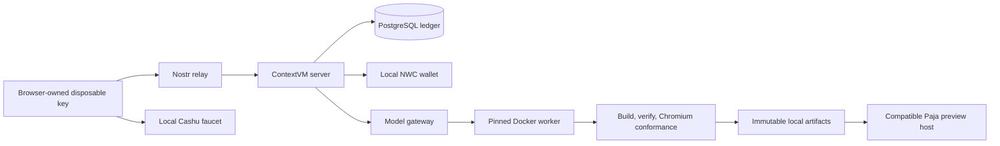

# Development GUI runbook

This runbook operates the local development workspace. It is development evidence only. Its Cashu and NWC rails use local test money, but enabling a configured provider can make billable model API calls. It does not authorize a production deployment, complete `SESS-02` or `OPS-01` through `OPS-04`, or remove the release gates in [production-readiness-deferred.md](production-readiness-deferred.md).

## Start and inspect

Use Bun 1.3.14 and Docker with Compose 2.39 or newer, Linux ARM64 worker support, and AMD64 relay emulation. Install the repository and its frozen dependencies, then start the complete local stack:

```sh
bun install --frozen-lockfile
bun scripts/dev.ts up
bun scripts/dev.ts status
```

`up` owns the service graph and emits the loopback workspace URL only after its semantic readiness checks pass. Do not construct a URL from a guessed port. `status` emits a redacted JSON object containing `ready`, `url`, `mode`, `stateRoot`, and `configPath`; it never prints bearer material, private keys, database credentials, NWC connection secrets, or provider credentials.

The launcher accepts the following stable commands:

| Command | Result |
| --- | --- |
| `bun scripts/dev.ts up` | Idempotently creates or reuses one local development instance. |
| `bun scripts/dev.ts status` | Reports redacted readiness and state locations. |
| `bun scripts/dev.ts test --case=contextvm-funding` | Exercises browser identity, ContextVM relay, Cashu/NWC rails, and SQL funding. |
| `bun scripts/dev.ts test --case=generation-preview` | Exercises source proposal, metering, worker build, verification, artifact storage, and compatible preview. |
| `bun scripts/dev.ts test --case=continuation-revision` | Exercises pending-action funding, restart, explicit resume, and immutable revisions. |
| `bun scripts/dev.ts test --case=full` | Runs the composed browser journey and security/accessibility gate. |
| `bun scripts/dev.ts down` | Stops the instance while preserving its data. |
| `bun scripts/dev.ts reset --confirm` | Removes only that instance after an explicit destructive confirmation. |

To isolate a second local run, set a safe instance name before every command:

```sh
export NAPPLET_CVM_DEV_INSTANCE=test-review
bun scripts/dev.ts up
```

Its state lives under `.local/napplet-cvm-dev/<instance>/`. The default instance is local development state; test invocations create their own isolated instances and do not reset it.

## Try the execution flow

1. Open the URL from `up` and click **Connect**. The disposable identity survives reloads and service restarts in this browser tab. Closing the tab can discard that identity.
2. Enter `10000` under **Cashu amount (sats)** and click **Fund with Cashu**. To exercise the other rail, enter `64` under **NWC amount (sats)** and click **Fund with NWC**. These are local test funds.
3. Enter a focused idea, keep the displayed maximum at or above the active action ceiling, and click **Generate napplet**. Wait for **Verified preview ready**, then use the counter in the sandboxed preview. Deterministic mode exercises execution with a request-dependent counter fixture; configure the model provider for open-ended generation.
4. Enter a revision and click **Revise selected version**. Each revision requests a new approved maximum and creates an immutable version. Select a version to load its verified preview.
5. To test funding recovery after two revisions, enter a new idea and maximum `5000`, then click **Generate napplet**. When the account cannot cover that maximum, the action is saved. Reload or restart the service, connect again, add `5000` Cashu test sats, and click **Resume**. Funding alone never starts the saved action.

The deterministic profile currently requires a 3,250-sat authorization ceiling and charges 5 test sats per successful model operation. The UI distinguishes settled funds, held funds, and funds available for new admissions. Unspent admission holds remain reserved; the available balance therefore falls by the approved maximum even though the exact charge is smaller. Confirmed reset discards this development account state.

Publication currently displays **Publication unavailable in this development setup**.

## What runs locally

The workspace is a loopback-only service graph:



The browser's disposable Nostr key stays in browser session storage. The server derives its development identity from private local funding material and exposes only its public key in bootstrap data. The browser never receives the server signer, database credentials, model-provider credentials, payment wallet material, preview-grant signing material, or the pending-action envelope key.

HTTP is deliberately narrow: static workspace assets, non-secret bootstrap facts, health, expiring preview bytes, and the local Cashu faucet are served over HTTP. Account, funding, generation, revision, and resume commands travel as signed/encrypted ContextVM messages over the local relay. The preview's nested applet runs in an opaque `sandbox="allow-scripts"` context with storage, relay, Nostr extension, and network access denied by policy.

## Model modes and publication

The normal mode is **Deterministic fixture**. It substitutes only the external model result; every other local boundary listed above remains real. The UI and `status` must label that mode explicitly.

An optional configured provider requires **all** of `OPENAI_API_KEY`, `NAPPLET_CVM_OPENAI_MODEL`, `NAPPLET_CVM_OPENAI_PROFILE`, `NAPPLET_CVM_OPENAI_PRICE_CARD`, and `NAPPLET_CVM_OPENAI_PRICE_SOURCES`. The model must be an accepted Responses model (`gpt-5-mini` or `gpt-5-mini-2025-08-07`). The profile, price card, and price-source variables are JSON values, not paths to JSON files: they are parsed at startup, and their IDs, source digests, evidence freshness, price-card validity, and usage ceilings must agree. `NAPPLET_CVM_OPENAI_PRICE_SOURCES` includes the captured source bytes and their SHA-256 values. Any partial or invalid configuration fails startup instead of falling back silently. `OPENAI_API_KEY` enables outgoing, billable model API calls; provide it only in your local environment before `up`, never in repository files, screenshots, logs, or issue reports. A configured-provider run is conditional evidence, and `status`/the workspace must say which mode actually ran.

Publication is unavailable unless a configured publication implementation reports durable availability. In an ordinary development run the workspace must say **“Publication unavailable in this development setup.”** Do not interpret generated artifacts or preview visibility as a publication success.

## Persistence, inspection, and recovery

`down` retains the selected local payment database/wallet state, pending-action checkpoints, artifact bytes, preview grants, and durable worker outputs. A later `up` reuses that state, validates migration checksums, and recovers the same local service identity. Use `reset --confirm` only when intentionally discarding the selected instance; it scopes Docker resources and `.local` state to this repository and instance.

Saved actions pin the worker image identity. The local launcher uses one fixed build project for the shared worker image and disables timestamped build attestations with explicit `--provenance=false --sbom=false`. Cached builds therefore preserve that identity across restarts and separate development instances. Payment services and data remain scoped to each instance. `status` rejects an outdated running worker identity; `up` restarts that service with the current image. Changing actual toolchain contents still invalidates an old pending action. These settings affect the development build only; the production provenance contract is unchanged. See Docker's [Compose build options](https://docs.docker.com/reference/cli/docker/compose/build/).

Private development files are under `.local` and are ignored by git. `status` identifies the selected `configPath` and `stateRoot`; under that root, pending-action keys, artifacts, and worker recovery data remain local-only. Treat these files as local secrets or sensitive test material. The launcher reports paths, never contents.

After `status` reports ready, use the PostgreSQL URL from the private `configPath` locally to inspect durable evidence. For example, compare action results with ledger and artifact state without copying credentials into shell history:

```sh
CONFIG_PATH="$(bun scripts/dev.ts status | jq -r .configPath)"
DB_URL="$(jq -r .databaseUrl "$CONFIG_PATH")"
psql "$DB_URL" -c "select operation_id, state, receipt_charge, artifact_id, settled_at from metered_actions order by settled_at desc nulls last, operation_id desc limit 10"
psql "$DB_URL" -c "select checkpoint_id, state, maximum_sat, expires_at_ms from development_pending_actions order by created_at desc limit 10"
psql "$DB_URL" -c "select artifact_id, session_id, aggregate_sha256 from development_artifacts order by created_at desc limit 10"
```

Use the workspace timeline and version list as the user-facing projection. Querying SQL is diagnostic-only; it does not authorize a state transition or a preview.

If `up` fails, start with `bun scripts/dev.ts status`. It checks frozen browser dependencies and Chromium, local payment services, migrations, relay and ContextVM identity, active model/price-card mode, pinned worker image/toolchain, artifact/grant stores, and compatible-host provenance. Correct the reported prerequisite, then rerun `up`; do not delete unrelated Docker resources. If the selected local instance is intentionally unrecoverable, use `reset --confirm` and start again.

The host Chromium readiness check runs in a bounded child process. This keeps its browser pipes separate from the service's listening sockets, containing a [reported Bun 1.3.14 child-process descriptor finalization issue](https://github.com/microsoft/playwright/issues/42692). The regression command is `bun run tests/dev-ui/contextvm-server-liveness.e2e.ts`; it forces collection and checks the actual service after 65 seconds without browser activity.

## Test evidence and limits

On 2026-10-15, `bun scripts/dev.ts test --case=full` passed all eight cases: both payment rails/replay, generation/preview, preview isolation/provider-mode reporting, saved-action restart/resume, revision replay/history, security/accessibility, preview access boundaries, and the complete detached-service journey. The configured paid-provider branch explicitly reported `skipped_without_credentials`.

The ten-stage full journey compared the UI with PostgreSQL after every action. It produced three initial versions and one resumed artifact: exactly four actions, provider operations, receipts, debit entries, worker results, and verified artifacts, charging 20 test sats in total. Cashu replay added no credit; funding alone left the saved action pending. Launcher persistence/reset and the 65-second idle/collection regression also passed. Responsive screenshots at 375, 768, and 1280 pixels have no page overflow. Private reports and screenshots are in `.local/development-gui-evidence/`; the accepted suite log is `.local/gui-full-suite-accepted.log`.

The worker's current local conformance report records **5 passed, 0 failed, and 5 skipped** checks. The skips remain visible evidence and do not mean that skipped checks passed. The ARM64 GitHub Actions workflow is added and its YAML is validated; it has not been run remotely in this session.

The named tests cover real local browser, relay, payment, SQL, worker, verifier, artifact, compatible-host, continuation, and security boundaries. They do not establish production service availability, regional failover, protected release authorization, real Lightning routing, production provider custody, or publication deployment. Those remain deferred in [production-readiness-deferred.md](production-readiness-deferred.md).

## Safe cleanup

```sh
bun scripts/dev.ts down
# State remains available for the next `up`.

bun scripts/dev.ts reset --confirm
# Only the selected repository development instance is removed.
```

Do not run broad Docker prune commands to recover this workspace. They can remove unrelated projects and are outside the launcher's scoped cleanup contract.
